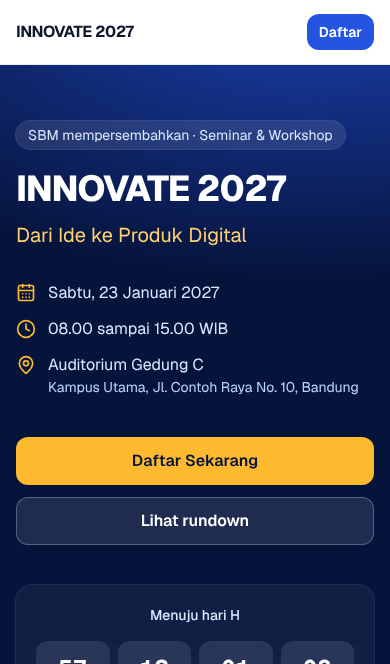
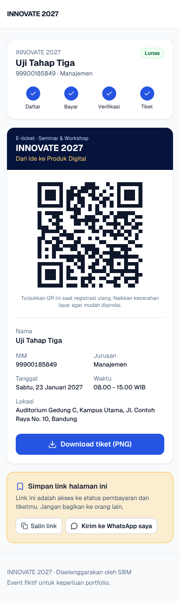
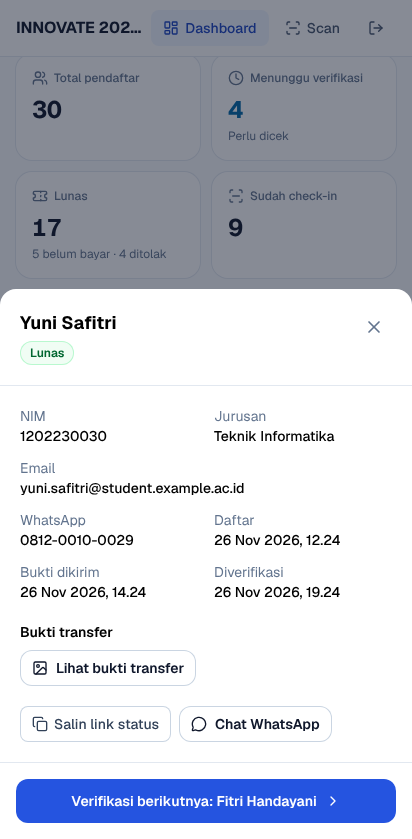
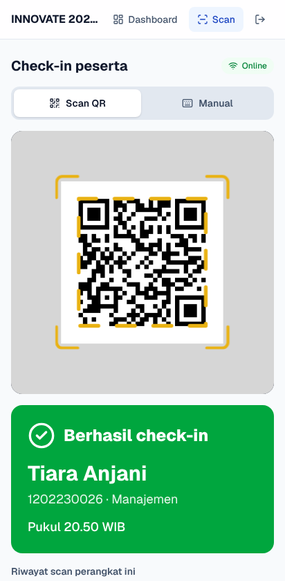
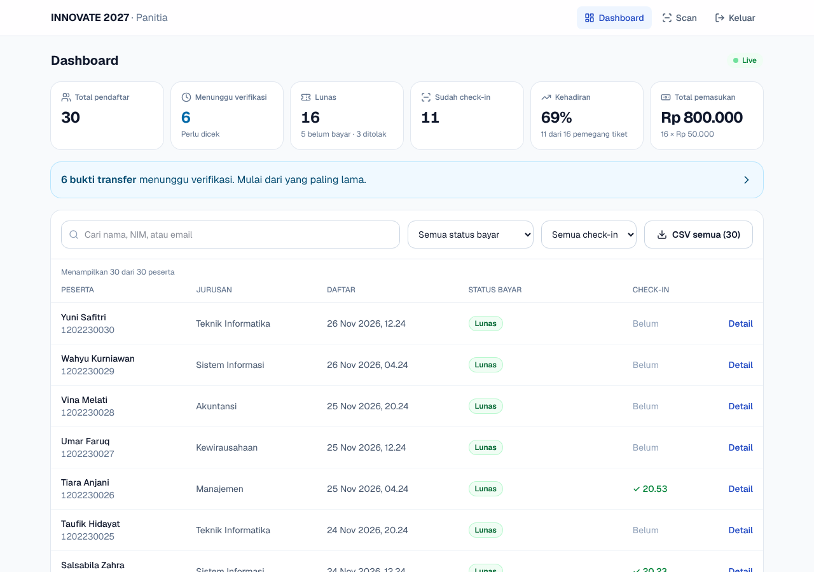
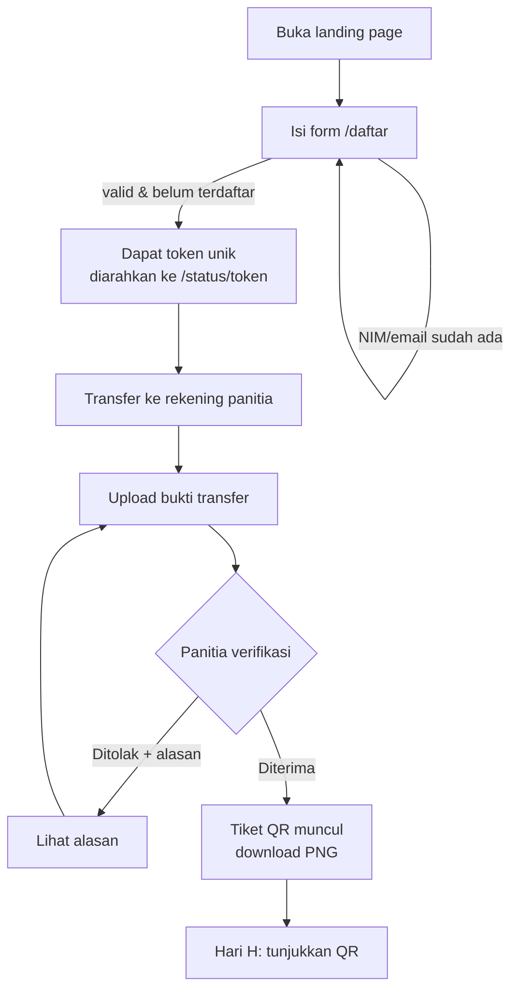
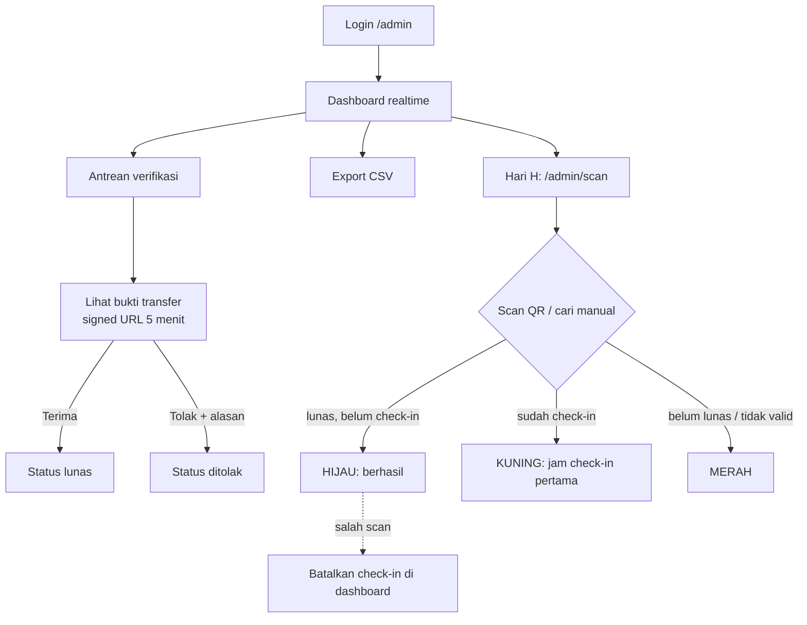
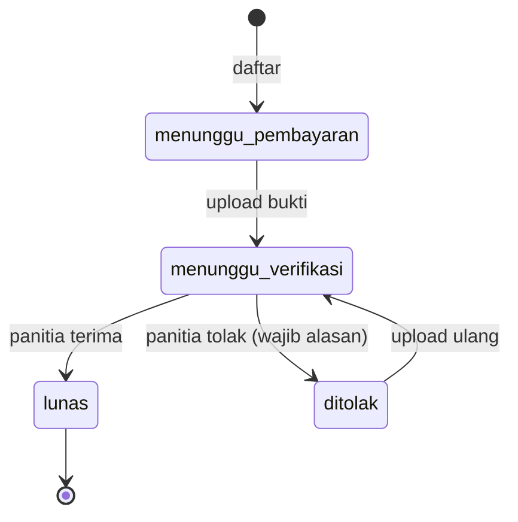
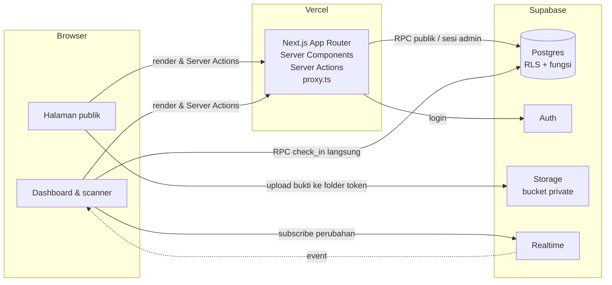
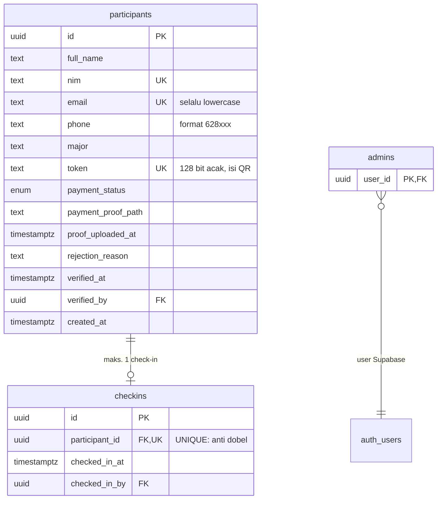

# INNOVATE 2027: Platform Event Kampus

Platform event all-in-one untuk kepanitiaan kampus: **landing page, registrasi, pembayaran transfer, tiket QR, check-in hari H, dan dashboard panitia**. Semua konten event diatur dari satu file config, jadi platform yang sama bisa dipakai ulang untuk event lain.

> Event, pembicara, dan rekening di repo ini fiktif. Penyelenggara: SBM.

**Demo:** https://webevent-omega.vercel.app · **Login panitia:** `/admin/login`

---

## Daftar isi

- [Masalah yang diselesaikan](#masalah-yang-diselesaikan)
- [Fitur](#fitur)
- [Screenshot](#screenshot)
- [Alur peserta dan panitia](#alur-peserta-dan-panitia)
- [Arsitektur](#arsitektur)
- [Skema database](#skema-database)
- [Keamanan](#keamanan)
- [Menjalankan secara lokal](#menjalankan-secara-lokal)
- [Deploy ke Vercel](#deploy-ke-vercel)
- [Memakai untuk event lain](#memakai-untuk-event-lain)
- [Keputusan teknis](#keputusan-teknis)
- [Pengujian](#pengujian)
- [Struktur folder](#struktur-folder)

---

## Masalah yang diselesaikan

Pendaftaran event kampus biasanya tersebar di Google Form, bukti transfer dikirim lewat chat, rekap di spreadsheet, dan check-in hari H dicentang manual di kertas. Akibatnya:

- Bendahara harus mencocokkan puluhan screenshot transfer secara manual.
- Peserta tidak tahu apakah pembayarannya sudah diterima.
- Antrean registrasi ulang panjang, dan satu tiket bisa dipakai dua kali.
- Data tercecer, sehingga sulit tahu berapa yang sudah bayar dan sudah hadir.

Platform ini menyatukan seluruh alur di satu tempat dengan status yang jelas bagi peserta dan panitia.

## Fitur

**Peserta**

- Landing page responsif: countdown, tentang acara, pembicara, rundown, harga, FAQ, dan kontak.
- Form pendaftaran dengan validasi NIM, email, dan nomor WA. NIM dan email tidak bisa dipakai dua kali.
- Halaman status pribadi (`/status/<token>`) berisi:
  - instruksi transfer dengan tombol salin dan batas waktu,
  - upload bukti transfer. Foto besar dikompres otomatis di HP. Kalau ditolak, peserta bisa upload ulang.
- Status diperbarui otomatis. Tiket QR muncul begitu pembayaran diterima, dan bisa di-download sebagai PNG.

**Panitia**

- Login email + password (Supabase Auth).
- Dashboard realtime:
  - total pendaftar, menunggu verifikasi, lunas, sudah check-in, persentase kehadiran, dan total pemasukan,
  - antrean verifikasi, pencarian, filter status bayar dan check-in.
- Verifikasi pembayaran:
  - lihat bukti transfer lewat signed URL yang berlaku 5 menit,
  - terima, atau tolak dengan alasan.
- Export CSV, semua peserta atau hasil filter.
- Batalkan check-in kalau salah scan.
- Halaman scan hari H:
  - kamera HP dengan hasil besar berwarna (hijau/kuning/merah), getar dan bunyi,
  - check-in manual lewat nama atau NIM.

## Screenshot

| Landing                                  | Status + tiket                       | Dashboard                                    | Scan                               |
| ---------------------------------------- | ------------------------------------ | -------------------------------------------- | ---------------------------------- |
|  |  |  |  |



## Alur peserta dan panitia

### Alur peserta



### Alur panitia



### Status pembayaran



## Arsitektur



- **Next.js 16 (App Router)** dengan Cache Components. Landing page dirender statis saat build. Halaman yang bergantung pada data (status, dashboard) memuat datanya di dalam `<Suspense>`.
- **Supabase Postgres** menjadi batas keamanan utama. Semua aturan bisnis penting ada di fungsi Postgres dan RLS, bukan hanya di kode aplikasi.
- **Tidak ada secret key di server aplikasi.** Vercel hanya butuh URL dan publishable key.

## Skema database



**Fungsi Postgres**

| Fungsi                                | Dipanggil oleh | Kegunaan                                             |
| ------------------------------------- | -------------- | ---------------------------------------------------- |
| `register_participant(...)`           | publik         | Daftar, mengembalikan token                          |
| `get_participant_by_token(token)`     | publik         | Data status milik sendiri (kolom terbatas)           |
| `submit_payment_proof(token, path)`   | publik         | Catat bukti setelah upload, cek path & file          |
| `can_upload_payment_proof(name)`      | policy Storage | Izinkan upload hanya ke folder token yang valid      |
| `is_admin()`                          | policy RLS     | Apakah user login terdaftar di `admins`              |
| `verify_payment(id, approve, reason)` | admin          | Terima/tolak, hanya dari status menunggu verifikasi  |
| `check_in(token \| id)`               | admin          | `berhasil` / `sudah` / `belum_lunas` / `tidak_valid` |
| `undo_check_in(id)`                   | admin          | Batalkan check-in                                    |
| `dashboard_stats()`                   | admin          | Statistik dalam satu query                           |

Migration ada di [`supabase/migrations/`](supabase/migrations).

## Keamanan

| Ancaman                                        | Penanganan                                                                                                                                  |
| ---------------------------------------------- | ------------------------------------------------------------------------------------------------------------------------------------------- |
| Orang luar membaca data peserta                | Role `anon` tidak punya akses tabel sama sekali (`REVOKE`). Data hanya lewat fungsi yang butuh token 128 bit.                               |
| User login yang bukan panitia                  | RLS memeriksa `is_admin()` (tabel `admins`), bukan sekadar "sudah login".                                                                   |
| Admin mengubah data diri peserta               | Column-level grant: admin hanya bisa mengubah kolom verifikasi.                                                                             |
| Bukti transfer bocor                           | Bucket private. Admin melihat lewat signed URL 5 menit.                                                                                     |
| Upload ke folder orang lain / file palsu       | Policy Storage hanya mengizinkan folder token yang statusnya boleh upload. `submit_payment_proof` memeriksa ulang path dan keberadaan file. |
| Check-in dobel saat dua panitia scan bersamaan | `UNIQUE(participant_id)` + `INSERT ... ON CONFLICT DO NOTHING`.                                                                             |
| QR tiket difoto dan disebar                    | QR hanya berisi token acak, tanpa data pribadi. Scan kedua ditandai kuning.                                                                 |
| Token bocor lewat Referer                      | Halaman status memakai `referrer: no-referrer` dan `noindex`.                                                                               |
| Input yang melewati validasi browser           | Validasi zod diulang di Server Action, dan CHECK constraint di database.                                                                    |
| CSV injection saat export                      | Sel yang diawali `= + - @` dinetralkan.                                                                                                     |
| Open redirect setelah login                    | Parameter `next` hanya boleh mengarah ke `/admin`.                                                                                          |
| Spam bot di form                               | Honeypot field.                                                                                                                             |

> Security Advisor Supabase menandai 4 fungsi `SECURITY DEFINER` yang bisa dipanggil publik (`register_participant`, `get_participant_by_token`, `submit_payment_proof`, `is_admin`). Ini disengaja: fungsi tersebut adalah satu-satunya pintu akses publik, dan masing-masing memvalidasi input serta membatasi kolom yang dikembalikan.

## Menjalankan secara lokal

Prasyarat: Node.js 20.9 atau lebih baru, dan akun [Supabase](https://supabase.com) (gratis).

### 1. Siapkan project Supabase

1. Buat project baru di Supabase.
2. **Authentication > Sign In / Providers**: matikan _Allow new users to sign up_.
3. **SQL Editor**: jalankan file di `supabase/migrations/` berurutan (nama file diawali tanggal). Alternatif: `npx supabase link` lalu `npx supabase db push`.
4. **Project Settings > API Keys**: salin Project URL dan publishable key. Secret key hanya dibutuhkan untuk `npm run seed`.

### 2. Environment variable

```bash
cp .env.example .env.local
```

Isi `NEXT_PUBLIC_SUPABASE_URL` dan `NEXT_PUBLIC_SUPABASE_PUBLISHABLE_KEY`. Untuk seed, isi juga `SUPABASE_SECRET_KEY`, `SEED_ADMIN_EMAIL`, dan `SEED_ADMIN_PASSWORD`.

### 3. Install, seed, jalankan

```bash
npm install
npm run seed
npm run dev
```

`npm run seed` membuat:

- akun admin demo,
- 30 peserta: 5 belum bayar, 6 menunggu verifikasi, 3 ditolak, 16 lunas,
- bukti transfer dummy,
- 10 check-in.

Script juga mencetak contoh link `/status/<token>` untuk tiap status. Untuk mengulang dari awal: `npm run seed -- --reset`.

> Kamera hanya bisa dipakai di HTTPS atau `localhost`. Untuk mencoba scanner di HP, gunakan URL hasil deploy.

## Deploy ke Vercel

1. Import repo ini di [vercel.com/new](https://vercel.com/new). Framework terdeteksi otomatis (Next.js).
2. Isi environment variable (Production & Preview):
   - `NEXT_PUBLIC_SUPABASE_URL`
   - `NEXT_PUBLIC_SUPABASE_PUBLISHABLE_KEY`
3. Deploy. Setiap push ke branch production akan ter-deploy otomatis.
4. (Opsional) Di Supabase **Authentication > URL Configuration**, isi _Site URL_ dengan domain Vercel.

Tidak perlu secret key di Vercel.

## Memakai untuk event lain

1. Ubah [`src/config/event.ts`](src/config/event.ts): nama, tanggal, lokasi, harga, rekening, pembicara, rundown, FAQ, kontak, dan format NIM. TypeScript akan menolak build kalau ada field yang terlewat.
2. (Opsional) Ganti warna di token `--color-brand-*` pada [`src/app/globals.css`](src/app/globals.css).
3. Buat project Supabase baru dan jalankan migration.
4. Tutup pendaftaran kapan saja dengan `registration.open: false`.

## Keputusan teknis

| Keputusan                                                            | Alasan                                                                                                                                                                                                                                      |
| -------------------------------------------------------------------- | ------------------------------------------------------------------------------------------------------------------------------------------------------------------------------------------------------------------------------------------- |
| **Konten event di file config, bukan tabel**                         | Landing page bisa statis (cepat, tanpa query), perubahan tercatat di git, tidak perlu UI admin untuk konten.                                                                                                                                |
| **Akses publik lewat fungsi Postgres (RPC), bukan RLS policy biasa** | RLS tidak tahu token milik siapa dan tidak bisa membatasi kolom. Fungsi membuat aturannya eksplisit: input token, output kolom terbatas.                                                                                                    |
| **Tabel `admins` terpisah**                                          | "Sudah login" tidak sama dengan "panitia". Akun yang tidak terdaftar tidak bisa apa-apa walaupun signup tidak sengaja aktif.                                                                                                                |
| **Upload bukti langsung dari browser ke folder token**               | File tidak lewat server (tidak terbentur batas body Server Action), dan aplikasi tidak butuh secret key (least privilege).                                                                                                                  |
| **Kompresi foto di browser**                                         | Foto HP 3 sampai 8 MB, batas 2 MB. Dikecilkan otomatis jadi sekitar 300 sampai 1000 KB, jadi upload cepat di sinyal lemah.                                                                                                                  |
| **Check-in: `UNIQUE` + `ON CONFLICT DO NOTHING`**                    | Postgres sendiri yang menjamin satu peserta satu check-in, tanpa lock manual. Dibuktikan dengan `npm run test:race`.                                                                                                                        |
| **Scanner: `qr-scanner`, bukan `html5-qrcode`**                      | Decoding di Web Worker (UI tidak patah-patah), memakai `BarcodeDetector` bawaan bila ada, ukuran sekitar 16 KB, cepat di HP kelas bawah. `html5-qrcode` sudah tidak aktif dikembangkan. Library dibungkus satu komponen agar mudah diganti. |
| **Check-in langsung dari browser ke RPC**                            | Satu request kecil tanpa hop ke server Next.js. Timeout 8 detik + retry sekali yang aman karena `check_in` idempoten.                                                                                                                       |
| **Status peserta: polling, dashboard: Realtime**                     | Realtime butuh izin SELECT, dan role anon sengaja tidak diberi akses tabel. Admin punya akses, jadi dashboard memakai Realtime.                                                                                                             |
| **Realtime memicu `router.refresh()`**                               | Satu sumber data (query server), jadi angka dan tabel tidak mungkin berbeda. Event berdekatan digabung (debounce).                                                                                                                          |
| **QR dibuat di server sebagai SVG**                                  | Tampil tanpa JavaScript dan tajam di semua layar. Tiket PNG digambar manual di canvas supaya sama di semua HP.                                                                                                                              |
| **`getClaims()`, bukan `getSession()`**                              | `getClaims()` memverifikasi tanda tangan JWT. Isi `getSession()` di server berasal dari cookie apa adanya.                                                                                                                                  |
| **Migration baru, bukan mengedit yang lama**                         | Migration yang sudah diterapkan ke database tidak boleh diubah. Perubahan desain upload ditulis sebagai migration kedua.                                                                                                                    |

## Pengujian

```bash
npm test             # 44 unit test: validasi, format, filter, CSV, logika retry check-in
npm run test:db      # tes keamanan RLS ke database di DATABASE_URL
npm run test:race    # 20 check-in bersamaan ke Supabase, harus tepat 1 yang tercatat
npm run lint && npm run typecheck && npm run format:check
```

- **CI GitHub Actions** menjalankan lint, typecheck, unit test, dan build. CI juga menerapkan migration ke Postgres 16 (dengan stub Supabase) lalu menjalankan tes keamanan: 16 skenario untuk anon, user biasa, dan admin.
- **Uji end-to-end dengan Playwright** dilakukan selama pengembangan ke Supabase sungguhan, mencakup:
  - registrasi, upload, verifikasi, tiket, dan decode QR,
  - dashboard dan export,
  - scanner dengan kamera palsu berisi QR asli,
  - realtime.

## Struktur folder

```
src/
  app/
    page.tsx                    Landing page (statis)
    daftar/                     Form pendaftaran
    status/[token]/             Status pembayaran + tiket
    admin/login/                Login panitia
    admin/(protected)/          Dashboard & scan (cek sesi di layout)
    api/admin/export/           Export CSV
  actions/                      Server Actions (registrasi, pembayaran, admin, auth)
  components/                   UI per fitur: landing, registration, status, admin, scan
  config/event.ts               Semua konten event
  lib/                          Supabase client, validasi, format, filter, CSV, check-in
  proxy.ts                      Refresh sesi + proteksi /admin
  types/                        Tipe database & admin
supabase/
  migrations/                   Skema, fungsi, RLS, Storage, Realtime
  tests/                        Tes keamanan SQL + stub Supabase untuk CI
scripts/
  seed.ts                       Data demo
  race-test.ts                  Bukti check-in aman dari race condition
```
